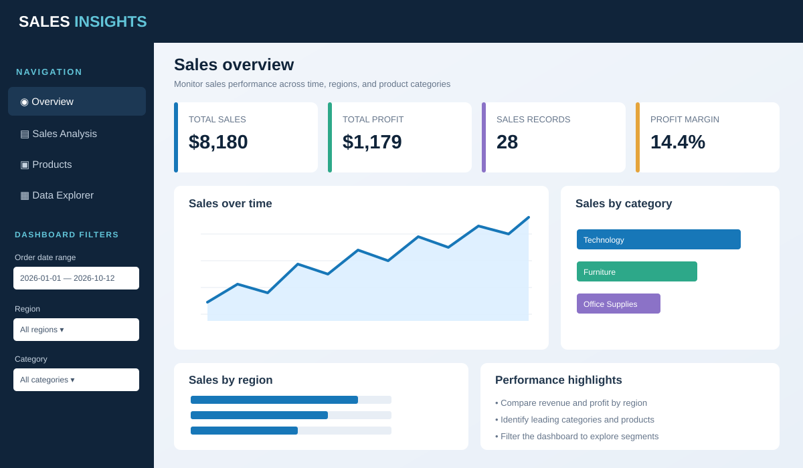

# Sales Performance Dashboard using Graphical Analysis in R

An interactive sales analytics dashboard built with **R Shiny**, **shinydashboard**, **ggplot2**, and **dplyr**. It includes KPI cards, interactive filters, trend analysis, category and regional comparisons, product analysis, and a searchable data table.

## Dashboard preview

The graphic below is a **design preview** of the dashboard layout. For actual runtime screenshots, run the app locally and save screenshots in `www/screenshots/`.



## Features

- KPI cards for total sales, total profit, sales record count, and profit margin
- Filters for order date, region, category, and customer segment
- Monthly sales trend and sales/profit comparisons
- Category, regional, and top-10 product charts
- Sales-versus-profit scatter plot
- Searchable, filterable data table
- Upload a compatible CSV and download filtered records

## Project structure

```text
sales-performance-dashboard-R-/
├── app.R
├── sample_sales.csv
├── data/
│   └── sample_sales.csv
├── dashboard_v2/
│   ├── app.R
│   └── styles.css
├── output/
│   └── README.md
├── www/
│   └── screenshots/
│       ├── README.md
│       └── dashboard-overview.svg
├── README.md
└── README_redesigned.md
```

- **`data/`** — sample sales dataset used by the redesigned app.
- **`output/`** — folder reserved for generated reports or locally saved analysis outputs. CSV downloads from the Shiny app are sent to the user's browser.
- **`www/screenshots/`** — dashboard preview and screenshots. Add real screenshots here after running the app; link them in this README.

## Requirements

Install R and optionally RStudio. Install the required packages:

```r
install.packages(c(
  "shiny", "shinydashboard", "ggplot2", "dplyr",
  "lubridate", "scales", "DT", "tidyr"
))
```

## Run the redesigned dashboard

From the repository root in RStudio, run:

```r
shiny::runApp("dashboard_v2")
```

Or set the working directory to `dashboard_v2` and run `shiny::runApp()`.

## Dataset format

The CSV must contain these columns:

`OrderDate, Region, Category, Product, Segment, Sales, Profit, Quantity`

- `OrderDate`: date in `YYYY-MM-DD` format
- `Sales`, `Profit`, `Quantity`: numeric values
- Other columns: text labels

The included data is synthetic and intended for demonstration. Replace it with an authorized dataset for real analysis.

## Adding screenshots

1. Run the dashboard in RStudio.
2. Capture the Overview, Sales Analysis, Products, and Data Explorer tabs.
3. Save the images under `www/screenshots/`, for example `overview.png`, `sales-analysis.png`, `products.png`, and `data-explorer.png`.
4. Embed them here using Markdown:

```markdown


```
